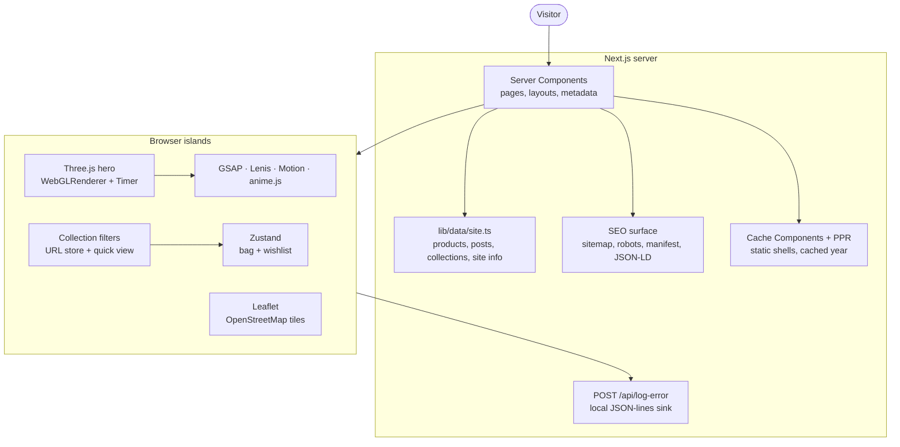

<div align="center">
  
</div>

<p align="center">
  <a href="https://nextjs.org/"></a>
  <a href="https://react.dev/"></a>
  <a href="https://www.typescriptlang.org/"></a>
  <a href="https://tailwindcss.com/"></a>
  <a href="https://threejs.org/"></a>
  <a href="https://leafletjs.com/"></a>
  <a href="https://bun.sh/"></a>
</p>

<p align="center">
  
</p>

<p align="center">
  <strong>A cinematic, accessible fashion storefront concept</strong><br />
  <em>Swimwear, dresses, beachwear and after-dark pieces for every version of you.</em>
</p>

<p align="center">
  <code>Next.js 16</code> · <code>React 19</code> · <code>TypeScript</code> · <code>Tailwind v4</code> · <code>Three.js</code> · <code>GSAP</code> · <code>Leaflet</code>
</p>

> **Demo scope** — AURELLE is a front-end concept, not a live shop. There is no payment provider, authentication backend, database, email service or persistent cart. Protected pages use a browser-local demo session; fictional contact details, social links and inventory are used throughout.

<details>
<summary><strong>Contents</strong></summary>

- [Overview](#overview)
- [What is included](#what-is-included)
- [Routes](#routes)
- [Tech stack](#tech-stack)
- [Architecture](#architecture)
- [Design system](#design-system)
- [Getting started](#getting-started)
- [Project structure](#project-structure)
- [Accessibility and performance](#accessibility-and-performance)
- [SEO and metadata](#seo-and-metadata)
- [Development error log](#development-error-log)
- [Demo boundaries](#demo-boundaries)
- [Credits](#credits)

</details>

---

## Overview

**AURELLE** is a fictional Paris-based fashion house built as a complete editorial storefront. The experience is designed to feel like a magazine rather than a template: oversized serif typography, warm burgundy and champagne tones, generous whitespace, and motion that supports the product instead of competing with it.

The build is equally focused on the engineering behind the visuals:

- A hand-built Three.js hero with a custom vertex ripple, animated rings, champagne dust and pointer parallax.
- A single motion system split cleanly between GSAP/ScrollTrigger, Lenis, Motion and anime.js.
- URL-driven collection filtering and quick views that keep the product grid in the server-rendered HTML.
- A server-rendered contact form with URL prefill, and a real Leaflet map with an accessible fallback.
- A hydration-safe demo auth gate with validated return paths and an editorial header that adapts to session state.
- Strict TypeScript, React 19 lint rules, Next.js 16 Cache Components, and a documented error log from the development process.

<p align="center">
  
  <br />
  <sub><em>Campaign still from the AURELLE summer concept.</em></sub>
</p>

## What is included

| Area | Details |
| --- | --- |
| **Cinematic hero** | Framework-free Three.js scene rendered with a transparent WebGL canvas. Uses `THREE.Timer`, a custom ripple shader, warm studio lighting, floating sculptural meshes and pointer parallax. Falls back to a static gradient when WebGL is unavailable. |
| **Editorial home** | Split hero, animated marquee, six-collection showcase, signature product rail, journal preview, brand story, benefits and newsletter capture. |
| **Collection browser** | Search, category filters, saved-only view, price sorting, wishlist state and an animated URL-driven quick view. |
| **Product quick view** | Shareable `?piece=` URLs, keyboard/Escape handling, focusable close control, size selection, add-to-bag feedback and body scroll locking. |
| **Bag and wishlist** | Shared Zustand state, live bag count, thumbnail drawer and remove controls. Intentionally in-memory only. |
| **Membership page** | Three tiers, a comparison table, FAQ accordion and plan-aware contact links. |
| **Journal** | Three editorial posts with static generation, previous/next navigation, campaign galleries and article metadata. |
| **Atelier contact** | Server-rendered enquiry form, plan prefill from `?plan=`, topic selector, validation, demo success state, Leaflet/OpenStreetMap map and gallery. |
| **Auth flows** | Two distinct signup concepts: an animated split-frame carousel journey at `/signup` and a browser-window account screen with wireframe terrain at `/create-account`. Validated forms create a browser-local session, then the header swaps its Sign In/Sign Up previews for search, favorites, profile and cart controls. Collection, About, Journal, Membership and Contact redirect to login with a safe return path. |
| **Motion** | GSAP + ScrollTrigger for scroll and load choreography, Lenis for smooth scrolling, Motion for UI transitions, anime.js for the sunburst accent. Every layer respects `prefers-reduced-motion`. |
| **SEO** | Metadata factory, canonical URLs, Open Graph and Twitter cards, JSON-LD, sitemap, robots and web manifest. |
| **Error telemetry** | Error boundaries report runtime failures to `POST /api/log-error`, which appends JSON lines to `ErrorLog/runtime-errors.log` locally. |

## Routes

| Route | Purpose |
| --- | --- |
| `/` | Editorial home page and cinematic hero |
| `/collection` | Searchable, filterable product catalogue |
| `/collection?category=Dresses` | Shareable category filter |
| `/collection?piece=aurelle-01` | Shareable product quick view |
| `/about` | Brand story, timeline, values and campaign galleries |
| `/blog` | Journal index |
| `/blog/the-summer-edit` | Journal article |
| `/blog/behind-the-atelier` | Journal article |
| `/blog/postcard-from-positano` | Journal article |
| `/pricing` | Membership tiers, comparison table and FAQ |
| `/contact` | Enquiry form, atelier details and Leaflet map |
| `/signup` | "Build Your Flow" split-frame signup concept |
| `/create-account` | Browser-window account signup concept |
| `/login` | Demo login form |
| `/terms` | Terms of Service |
| `/privacy` | Privacy Policy |
| `/sitemap.xml` | Generated sitemap |
| `/robots.txt` | Generated crawler rules |
| `/manifest.webmanifest` | Installable web app metadata |
| `/api/log-error` | Local runtime error sink |

> **Protected routes** — `/collection`, `/about`, `/blog`, `/pricing` and `/contact` require a demo session. Unauthenticated visitors are sent to `/login?next=...`; the return path is validated to stay on the same origin and cannot loop back to an auth route. Signing in or creating an account stores only a name and email in `localStorage` under `aurelle-auth`.

## Tech stack

| Layer | Technology | Role |
| --- | --- | --- |
| Framework | **Next.js 16.4.3** | App Router, Server Components, Cache Components, Partial Prefetching, Turbopack |
| UI runtime | **React 19.3** | Client islands, transitions, `useDeferredValue`, `useSyncExternalStore` |
| Language | **TypeScript 5** | Strict typed content, product and metadata models |
| Styling | **Tailwind CSS v4** | Token-driven utilities, responsive layout and custom effects |
| 3D | **Three.js 0.186** | WebGL hero, custom shader ripple and `THREE.Timer` render loop |
| Scroll motion | **GSAP 3.15 + ScrollTrigger + @gsap/react** | Load timelines, clip reveals, parallax and scroll progress |
| Smooth scroll | **Lenis 1.3** | Inertia scrolling with GSAP ticker integration |
| UI motion | **Motion 14** | Quick view, mobile menu and bag transitions |
| Decorative motion | **anime.js 4.5** | Slow sunburst rotation |
| State | **Zustand 5** | Shared bag, wishlist and browser-local auth state |
| Map | **Leaflet 1.9 + OpenStreetMap** | Interactive atelier map with custom marker |
| Icons | **react-icons 5** | Feather icon set and auth social marks |
| Forms | **react-hook-form 7 + Zod 4** | Accessible validation, touched state and demo submission states |
| Fonts | **next/font** | Self-hosted Bodoni Moda, Manrope and auth-specific Onest, Inter Tight and Hanken Grotesk |
| Tooling | **Bun 1.4.2, ESLint 9, eslint-config-next** | Install, scripts, linting and production builds |

> The hero originally used React Three Fiber. It was replaced with a framework-free Three.js scene so the render loop could use the current `THREE.Timer` API without patching a dependency. See [Error 007](ErrorLog/007-three-clock-deprecated.md).

## Architecture



**Key decisions**

- **The catalogue is server-rendered.** `CollectionExplorer` reads the query string through a small `useSyncExternalStore` URL store instead of `useSearchParams`, so the full product grid stays in the initial HTML. Only the quick-view dialog sits behind a Suspense boundary.
- **The URL is the filter state.** Category and quick-view selections are written with `history.replaceState`, keeping links shareable and the back button predictable.
- **The contact form is server-rendered.** `?plan=` is read as an external store and passed into a keyed field component, avoiding a mount effect and preserving real form markup for no-JS and SEO.
- **One owner per animation engine.** GSAP handles scroll choreography, Lenis handles inertia, Motion handles interface transitions, anime.js handles the sunburst, and Three.js owns the hero canvas.
- **Content lives outside components.** `lib/data/site.ts` is the single source for products, collections, posts, navigation, contact details and coordinates.

## Design system

| Token | Value | Use |
| --- | --- | --- |
| Cream | `#f7f2ea` | Page canvas and light surfaces |
| Sand | `#eadcc9` | Warm section blocks |
| Ink | `#161310` | Primary type and dark controls |
| Charcoal | `#241f1b` | Deep panels |
| Muted | `#6b625a` | Secondary copy |
| Ember | `#d4552d` | Accent, active states and CTAs |
| Burgundy | `#6c1b2b` | Editorial depth and 3D key material |
| Wine | `#3d0c16` | Darkest accent |

- **Display type:** Bodoni Moda, including italic, for headlines and editorial captions.
- **Body type:** Manrope for navigation, controls, body copy and metadata.
- **Shape:** `2rem` editorial frames, `1.25rem` cards and pill controls.
- **Texture:** fine grain overlays, arched image masks, ghost display words and hairline rules.
- **Motion:** slow, directional and purposeful. Reduced-motion visitors receive the final composed layout with decorative loops disabled.

## Getting started

### Prerequisites

- **Bun 1.4+** (recommended), or Node.js 20+ with npm
- A WebGL-capable browser for the hero scene
- Network access for OpenStreetMap tiles on `/contact`

### Install and run

```bash
bun install
bun run dev
```

Open [http://localhost:3000](http://localhost:3000).

With npm instead of Bun:

```bash
npm install
npm run dev
```

### Production build

```bash
bun run build
bun run start
```

### Scripts

| Command | Description |
| --- | --- |
| `bun run dev` | Start the Turbopack development server |
| `bun run build` | Create an optimized production build |
| `bun run start` | Serve the production build |
| `bun run lint` | Run ESLint with the Next.js React 19 rules |
| `bunx tsc --noEmit` | Type-check without emitting files |

No environment variables are required. The project is configured for local development and static/PPR deployment. `next.config.ts` pins the Turbopack workspace root and enables Cache Components plus Partial Prefetching.

## Project structure

```text
my-app/
├── app/
│   ├── about/                 # brand story and campaign galleries
│   ├── api/log-error/         # local runtime error sink
│   ├── blog/                  # journal index and [slug] articles
│   ├── collection/            # catalogue page and quick-view Suspense host
│   ├── contact/               # enquiry page, form and atelier map
│   ├── pricing/               # membership tiers and comparison
│   ├── (auth)/                # signup, create-account, login and legal routes
│   ├── globals.css            # tokens, typography, effects, Leaflet overrides
│   ├── layout.tsx             # fonts, metadata, header, footer, JSON-LD
│   ├── page.tsx               # home page + product JSON-LD
│   └── sitemap.ts             # generated route inventory
├── components/
│   ├── auth/                  # signup frames, account form, social and legal UI
│   ├── collection/            # filter browser and URL-driven quick view
│   ├── contact/               # contact form and Leaflet integration
│   ├── hero/                  # browser capability gate for the 3D scene
│   ├── home/                  # editorial home sections
│   ├── layout/                # header, account menu, footer, auth-aware chrome
│   ├── providers/             # Lenis + GSAP scroll provider
│   ├── three/                 # hero scene and wireframe terrain
│   └── ui/                    # cards, buttons, reveal, accordion, sunburst
├── lib/
│   ├── data/site.ts           # site copy, products, posts, collections
│   ├── data/auth.ts           # auth carousel and testimonial content
│   ├── auth-navigation.ts     # protected routes and safe auth return paths
│   ├── gsap.ts                # GSAP + ScrollTrigger registration
│   ├── report-error.ts        # client error reporter
│   ├── seo.ts                 # metadata and JSON-LD factories
│   ├── store/auth.ts          # browser-local persisted demo session
│   └── store/cart.ts          # in-memory Zustand bag + wishlist
├── Asserts/                   # supplied auth reference imagery
├── public/
│   ├── images/                # hero, collection, product and supplied assets
│   └── icon.svg               # favicon
├── ErrorLog/                  # numbered development error records
├── .github/assets/            # animated README banner and divider
└── next.config.ts             # Cache Components, PPR, Turbopack root
```

## Accessibility and performance

- **Reduced motion:** GSAP timelines, Lenis, anime.js, Motion transitions and the Three.js render loop all check `prefers-reduced-motion`.
- **Graceful 3D fallback:** WebGL capability is probed with `useSyncExternalStore`; unsupported devices receive a static editorial gradient.
- **Keyboard support:** skip link, Escape-to-close quick view and bag, visible focus styles, semantic landmarks and labelled controls.
- **Rendering:** static generation and Partial Prerendering keep page shells fast; the hero and Leaflet map are client-only and dynamically imported.
- **Media:** `next/image` with responsive `sizes`, explicit dimensions and optimized formats. The Three.js renderer caps pixel ratio at `1.5`.
- **Fonts:** `next/font` self-hosts Bodoni Moda and Manrope at build time, eliminating runtime Google Fonts requests.
- **Cleanup:** the Three.js scene disposes geometries, materials and the renderer; Leaflet removes its map instance; scroll locks are restored on unmount.
- **No analytics or tracking scripts** are included.

## SEO and metadata

- Shared `createMetadata` factory for canonical URLs, Open Graph and Twitter cards.
- Root metadata templates plus an explicit full home title (`AURELLE - Own your summer.`).
- Organization, WebSite, CollectionPage/ItemList and article structured data.
- Generated `sitemap.xml`, `robots.txt` and `manifest.webmanifest`.
- Auth and legal routes are marked `noindex, nofollow` so demo account pages stay out of search results.
- Semantic heading order, descriptive link labels and meaningful alt text.
- `metadataBase` configured in `app/layout.tsx`; update `site.url` in `lib/data/site.ts` before deploying to a real domain.

## Development error log

Every issue found during development is recorded in [`ErrorLog/`](ErrorLog/). The log captures the trigger, reasoning and verification, not just the final diff.

| # | Issue | Resolution |
| --- | --- | --- |
| [001](ErrorLog/001-dependency-misconfiguration.md) | Wrong `react-icon` / `react-motion` packages and undeclared Three.js dependencies | Installed `react-icons`, `motion`, `@gsap/react`, `three`; later removed R3F entirely in 007 |
| [002](ErrorLog/002-react-hooks-and-type-errors.md) | Effect cleanup returned an animation object; `setState` inside effects; generated files linted | Block-bodied cleanup, `useSyncExternalStore`, derived overlay state, generated-folder ignores |
| [003](ErrorLog/003-prerender-unstable-date.md) | Cache Components rejected `new Date()` during prerender | Added a `"use cache"` copyright-year helper |
| [004](ErrorLog/004-cache-components-route-runtime.md) | Route segment `runtime` config is illegal with Cache Components | Removed the redundant export; kept `node:fs` as the runtime signal |
| [005](ErrorLog/005-contact-form-set-state-in-effect.md) | Contact form copied `?plan=` into state inside a mount effect | External-store URL read + keyed fields; real form HTML is server-rendered |
| [006](ErrorLog/006-home-title-missing-brand.md) | Home title lost the AURELLE brand because templates do not apply to the same segment | Explicit full title in home metadata |
| [007](ErrorLog/007-three-clock-deprecated.md) | `THREE.Clock` deprecation warning from R3F's internal render clock | Replaced R3F with a framework-free Three.js scene using `THREE.Timer` |
| [008](ErrorLog/008-auth-breakpoints-and-notch.md) | Auth notch, split breakpoints, mobile padding and desktop H1 wrapping | Anchored the notch to the frame, restored tablet layouts, tuned card proportions and form width |
| [009](ErrorLog/009-browser-auth-gate.md) | Client-only session caused control flicker, a protected-route guard race on sign-out and a narrow-screen header overflow risk | Hydration-gated header, sanitized `next` paths, guard-aware sign-out, responsive skeleton and compact icon targets |

<details>
<summary><strong>001 - Dependency misconfiguration</strong></summary>

The starter contained `react-icon` (singular) and the 2015-era `react-motion`. The brief required `react-icons` and `motion/react`. Three.js and R3F were only transitive dependencies, so the app would have worked locally but failed on a clean install. The packages were corrected and direct dependencies were declared explicitly.

</details>

<details>
<summary><strong>002 - React hooks and generated-file lint noise</strong></summary>

An arrow-body effect cleanup returned the result of `animation.pause()` instead of `void`; TypeScript rejected it. Two effects wrote state synchronously after mount or navigation, triggering `react-hooks/set-state-in-effect`. The fixes used block-bodied cleanup, a cached WebGL capability store with `useSyncExternalStore`, and overlay state derived from the current pathname. A stray `app/.next` folder was removed and `**/.next/**` was added to the ESLint ignores.

</details>

<details>
<summary><strong>003 - Cache Components rejected <code>new Date()</code></strong></summary>

With `cacheComponents: true`, Next.js refuses to prerender unstable values. The footer's copyright year failed during `/_not-found` generation. Hard-coding the year would rot; moving it to the client would add a boundary for one number. An async `copyrightYear()` helper with `"use cache"` keeps the value stable for a year and allows static generation.

</details>

<details>
<summary><strong>004 - Route segment runtime conflict</strong></summary>

`export const runtime = "nodejs"` on the error API looked explicit but is incompatible with Cache Components. Node.js is already the default for this route handler, and `node:fs/promises` keeps it on Node. Removing the redundant export fixed the build without changing behavior.

</details>

<details>
<summary><strong>005 - Contact form effect cascade</strong></summary>

Using `useSearchParams` for `?plan=` forced a Suspense skeleton into the static HTML. Copying the value into state in an effect restored SSR but violated React 19's `set-state-in-effect` rule. The final design treats the URL as an external store: an outer component reads `?plan=`, and a keyed `ContactFormFields` initializes from the value as a prop. No effect and no hydration mismatch.

</details>

<details>
<summary><strong>006 - Home page title lost the brand</strong></summary>

Next.js title templates apply to child segments, not metadata defined in the same segment as the layout. The home page therefore emitted `Own your summer.` without the AURELLE suffix. Including the brand explicitly in the home metadata fixed it while preserving the template for every inner route.

</details>

<details>
<summary><strong>007 - THREE.Clock deprecation from R3F</strong></summary>

three r183 deprecates `Clock`, but `@react-three/fiber@9.8.2` still constructs `new THREE.Clock()` in its root store, so the warning appeared even though application code only read `state.clock`. Upgrading was not possible (9.8.2 was already latest), patching would have created a private dependency fork, and suppressing the warning would hide the deprecated path. The decorative hero was rewritten as a framework-free Three.js scene with `THREE.Timer`, explicit resize/cleanup handling, a reduced-motion branch and the same visual language. R3F and drei were removed from the project.

</details>

**What this log demonstrates:** dependency names are not interchangeable, framework modes change what is legal during prerender, URL state should be modeled as an external store, and a warning can reveal a dependency-level architectural mismatch rather than a local typo.

## Demo boundaries

- Cart and wishlist are **in-memory** and reset on reload. There is no checkout, payment or inventory service.
- Authentication is a **browser-local demo**: any valid email and password sign in, and only a display name plus email are persisted. There is no server session, password verification or account database. Use the profile menu to clear the session, or remove the `aurelle-auth` local-storage key.
- Contact and newsletter submissions are **simulated** with explicit UI copy; no email is sent or stored.
- Products, prices, membership tiers and journal articles are **fictional demo content**.
- The atelier address, phone number, coordinates and social links are **placeholders**.
- The Leaflet map needs network access for OpenStreetMap tiles; blocked tiles leave the styled container visible.
- Supplied campaign photography is used for this concept presentation. Replace it with licensed production assets before any commercial use.
- Runtime error logging writes to the local filesystem; serverless hosts with a read-only filesystem still return successfully and ignore the write.

## Credits

- Concept and front-end build: AURELLE project.
- Typography: [Bodoni Moda](https://fonts.google.com/specimen/Bodoni+Moda) and [Manrope](https://fonts.google.com/specimen/Manrope) via `next/font`.
- Map data and tiles: [OpenStreetMap contributors](https://www.openstreetmap.org/copyright).
- Built with [Next.js](https://nextjs.org/), [React](https://react.dev/), [Tailwind CSS](https://tailwindcss.com/), [Three.js](https://threejs.org/), [GSAP](https://gsap.com/), [Lenis](https://lenis.darkroom.engineering/), [Motion](https://motion.dev/), [anime.js](https://animejs.com/), [Zustand](https://zustand.docs.pmnd.rs/), [Leaflet](https://leafletjs.com/) and [react-icons](https://react-icons.github.io/react-icons/).
- This is a private concept project; photography and third-party assets remain the property of their original owners.

<div align="center">
  
  <sub>AURELLE · Own your summer. · Built with Next.js 16 and Three.js</sub>
</div>

# Aurelle_female_dress_all_in_one
